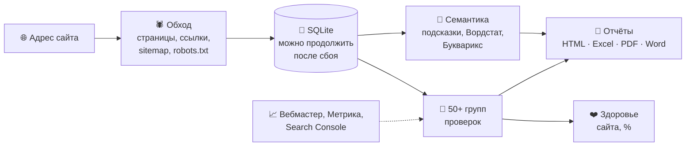

<div align="center">


# Clayler SEO

**Программа для технического SEO-аудита и сбора семантики сайтов**

Обходит сайт как поисковый робот, находит ошибки, считает «здоровье» сайта<br/>
и собирает готовые отчёты для себя, клиента и разработчика.


[Возможности](#-возможности) ·
[Как это работает](#-как-это-работает) ·
[Быстрый старт](#-быстрый-старт) ·
[Подключения](#-подключения) ·
[Командная строка](#-командная-строка) ·
[Структура](#-структура-проекта)

</div>

---

## 📖 О программе

Clayler SEO — настольная программа для SEO-специалиста. Вы вводите адрес сайта, программа проходит по всем его страницам, как это делает робот Яндекса или Google, и показывает, что мешает сайту попасть в поиск и продавать: битые ссылки, дубли, ошибки в title и H1, проблемы с индексацией, скоростью, мобильной версией и многое другое.

На выходе — не просто список ошибок, а набор готовых документов: отчёт для себя, понятный аудит для клиента, задачи разработчику, смета и ТЗ копирайтеру.

**Для кого:**

- SEO-специалисты и фрилансеры, которые делают аудиты сайтов для клиентов;
- владельцы сайтов и интернет-магазинов, которые хотят понять, что не так с сайтом;
- веб-студии, которым нужно быстро проверить сайт перед сдачей или после переезда.

> [!NOTE]
> Программа работает **только на вашем компьютере**. Окно открывается в браузере по адресу `127.0.0.1` — из интернета к нему не подключиться. Отчёты, ключи доступа и настройки никуда не отправляются.

---

## ✨ Возможности

### 🔍 Технический аудит

- **Обход сайта как поисковый робот** — по ссылкам, sitemap.xml и с учётом robots.txt (правила Google или Яндекса, Clean-param).
- **Больше 200 видов проблем** в 50+ группах проверок: коды ответа, редиректы и их цепочки, canonical, noindex, дубли, title / description / H1, ЧПУ, пагинация, hreflang, микроразметка Schema.org и Open Graph, смешанный контент, HTTPS, зеркала и склейка домена.
- **Режим JavaScript** — страницы открываются во встроенном Chromium, как их видит Google. Подходит для сайтов на React, Vue и Angular.
- **Скорость и мобильная версия** — как страница грузится и выглядит на телефоне, снимки экрана.
- **Безопасность** — открытые служебные файлы, признаки взлома и скрытые ссылки, клоакинг.
- **Контент** — орфография (Яндекс.Спеллер), водность и тошнота текста, каннибализация запросов, смешанные русские и латинские буквы.
- **«Что мешает покупать»** — программа сама нажимает «В корзину» и «Купить в один клик», проверяет формы, согласия на обработку данных и наличие товара.
- **Здоровье сайта** в процентах — одна понятная цифра, по которой видно, стало лучше или хуже.

### 📊 Отчёты

| Файл | Для кого | Что внутри |
|---|---|---|
| `отчёт.html` | для себя | все проблемы, страницы, схема внутренних ссылок («паутинка»), фильтры |
| `отчёт_для_клиента.html` | клиенту | аудит по 20 пунктам простыми словами, открывается без программы |
| `отчёт.xlsx` и CSV | для работы | сводка, список проблем с объяснениями, все страницы |
| PDF | клиенту | тот же аудит в PDF (через Chrome или Edge, которые уже стоят на компьютере) |
| `Задачи разработчику.docx` | разработчику | что исправить и где, с советами под движок сайта |
| `ТЗ копирайтеру.docx` | копирайтеру | задания на тексты по группам запросов |

А ещё — **готовые файлы-исправления** (robots.txt, sitemap.xml), **смета и план работ**, **экспресс-аудит на один лист** для первого контакта с клиентом и **снимки страниц с обведённой ошибкой**.

### 🧠 Семантика

- Поисковые подсказки Яндекса и Google — то, что люди на самом деле набирают в поиске.
- Точная частотность из Вордстата (через API Яндекс Директа).
- Запросы своего сайта и конкурентов из Букварикса (бесплатно).
- Группы запросов, правило «запрос → страница», каннибализация, бренды и модели товаров, синонимы, города.
- Семантика для сайта, которого ещё нет: структура будущего сайта.
- GEO — готовность сайта к ответам нейросетей (Нейро в Яндексе, Алиса, ChatGPT, Perplexity).

### 📈 Данные поисковиков

После входа в свой аккаунт программа добавляет в отчёт данные **Яндекс Вебмастера**, **Яндекс Метрики** и **Google Search Console**: что в индексе, какие страницы потеряли показы, «где теряем клики». Вход без пароля — через страницу Яндекса или Google, доступ только на чтение.

### 🤝 Работа с клиентами и автоматизация

- **Клиенты** — свои данные и логотип в отчётах, папка «для клиента» с файлами, ежемесячный отчёт об изменениях.
- **Сравнение** двух проверок одного сайта: что исправили, что сломалось — и **сравнение с конкурентами** (до 5 сайтов одновременно).
- **Метки у проблем** — «не ошибка», «передано разработчику» и другие, чтобы вести работу по сайту.
- **Очередь сайтов** — список проверяется сам, по одному (например, на ночь).
- **Наблюдение** — проверка по расписанию раз в неделю и мониторинг каждый час, пока окно открыто.
- **Уведомления** — со звуком в окне, в Windows и в **Telegram** через своего бота (команды `/status` и `/last`).

---

## 🔧 Как это работает



1. **Обход.** Программа загружает главную страницу и идёт по ссылкам, как поисковый робот. Каждый шаг редиректа записывается отдельно, адреса нормализуются, лишние параметры отбрасываются. Всё сохраняется в базу SQLite, поэтому прерванную проверку можно продолжить.
2. **Проверки.** Когда обход закончен, по собранным данным запускаются проверки: каждая отвечает за свою тему и находит свои проблемы.
3. **Данные поисковиков.** Если подключены Яндекс и Google, программа добавляет их данные к тому, что нашла сама.
4. **Отчёты.** Из одних и тех же результатов собираются отчёты для разных людей: для себя, клиента, разработчика и копирайтера.

Окно программы — это локальный веб-сервер на Python. Он открывает страницу в вашем браузере, а работает только на этом компьютере.

---

## 🚀 Быстрый старт

### Что нужно

- **Windows 10 или 11** (на других системах запуск вручную, см. ниже);
- **Python 3.9 или новее** — [скачать с python.org](https://www.python.org/downloads/). При установке поставьте галочку **«Add python.exe to PATH»**.

### Установка и запуск

1. Скачайте программу: зелёная кнопка **Code → Download ZIP** вверху этой страницы, или

   ```bash
   git clone https://github.com/TimurPanin/Clayler-SEO.git
   ```

2. Распакуйте архив и дважды щёлкните **`Clayler SEO.bat`**.
3. При первом запуске программа сама поставит нужные модули (`truststore` и `openpyxl`) и откроет окно в браузере.
4. Введите адрес сайта и нажмите **«Начать проверку»**.

> [!TIP]
> Есть и простой режим без окна: **`Запустить аудит.bat`** задаст 4 вопроса (адрес, сколько страниц, нужен ли JavaScript…) и откроет готовый отчёт в браузере.

### Режим JavaScript (по желанию)

Для сайтов, где меню, каталог или текст подгружаются скриптами, включите галочку **«Выполнять JavaScript»**. При первом включении программа скачает встроенный браузер Chromium (около 150–200 МБ, один раз). Можно поставить всё заранее одной командой — она сама установит модуль `playwright` и скачает Chromium:

```bash
python crawl.py --setup-js
```

> [!WARNING]
> В режиме JavaScript проверка идёт в несколько раз медленнее: каждая страница открывается в настоящем браузере.

### macOS и Linux

```bash
pip install truststore openpyxl
python app.py
```

Программа писалась под Windows: на других системах ключи доступа хранятся без шифрования, а уведомления Windows и звуки недоступны.

---

## 🔌 Подключения

Все подключения необязательны: без них программа делает полный технический аудит. Подключаются они в окне программы, в блоке **«Подключения»** слева. Там же есть пошаговая подсказка для каждого сервиса.

| Сервис | Что даёт | Что нужно один раз |
|---|---|---|
| **Яндекс Вебмастер и Метрика** | индексация, запросы, посещаемость, потерянные клики | своё приложение на [oauth.yandex.ru](https://oauth.yandex.ru/client/new) — ClientID и секрет |
| **Google Search Console** | показы, клики, страницы вне индекса | свой проект в [Google Cloud](https://console.cloud.google.com/), клиент типа Desktop app |
| **Яндекс Директ** | точная частотность из Вордстата | client_id и токен (ссылка на получение — в окне программы) |
| **Telegram** | сообщение, когда проверка закончилась или застряла | свой бот от [@BotFather](https://t.me/BotFather) и его токен |
| **Букварикс** | запросы сайта и конкурентов | ничего — работает бесплатно |

### 🔐 Где хранятся ключи

- Ключи и токены лежат в файле `данные/доступы.json` **только на вашем компьютере**. Этот файл исключён из git.
- На Windows они зашифрованы средствами системы (DPAPI): расшифровать их может только ваша учётная запись Windows.
- Вход в Яндекс и Google — без пароля: вы входите на их странице и нажимаете «Разрешить». Программа получает доступ **только на чтение**, а кнопка «Отключить» отзывает его.
- В журнал программы токены и пароли не попадают — вместо них пишется `•••`.

---

## 💻 Командная строка

Всё, что делает окно, можно запустить и из командной строки:

```bash
# Проверить сайт (по умолчанию до 10 000 страниц)
python crawl.py https://example.ru

# Большой сайт: больше страниц и потоков
python crawl.py https://example.ru --max-pages 50000 --threads 8

# Как видит робот Яндекса, с выполнением JavaScript
python crawl.py https://example.ru --robots yandex --ua yandexbot --js

# Продолжить прерванную проверку
python crawl.py https://example.ru --continue

# Проверить только адреса из файла (как режим List у Screaming Frog)
python crawl.py --list адреса.txt

# Сравнить две проверки одного сайта
python crawl.py --compare "отчёты/старая" "отчёты/новая"
```

Полный список параметров: `python crawl.py --help`.

---

## 📁 Структура проекта

```
Clayler-SEO/
├── Clayler SEO.bat        # запуск окна программы (двойной щелчок)
├── Запустить аудит.bat    # простой режим: 4 вопроса и готовый отчёт
├── app.py                 # окно программы (локальный сервер на 127.0.0.1)
├── crawl.py               # запуск из командной строки
├── seocrawler/
│   ├── crawler/           # обход сайта
│   ├── analyze/           # проверки и расчёт здоровья
│   │   └── checks/        # 50+ групп проверок, каждая в своём файле
│   ├── semantics/         # семантика: подсказки, Вордстат, группы, ТЗ
│   ├── window/            # окно программы: сервер и страницы
│   ├── run/               # сценарии запуска: обход, отчёт, сравнение
│   └── *.py               # отчёты, аудит, подключения, Telegram, очередь…
├── данные/                # ваши личные файлы (в git попадает только иконка)
└── тест/                  # автотесты и тестовые сайты
```

Около **49 000 строк** кода на Python. Для обхода и разбора страниц используется только стандартная библиотека Python, сторонние модули нужны лишь для Excel, HTTPS и режима JavaScript.

---

## 🧪 Тесты

В папке `тест/` больше 100 автотестов и несколько тестовых сайтов. Главный из них поднимает на компьютере тестовые сайты с заранее известными ошибками, проверяет каждый программой и сверяет найденное с эталоном:

```bash
python тест/проверить_всё.py
```

---

## 🗺️ Известные ограничения

- В режиме JavaScript большие сайты проверяются долго, а страницы с тяжёлыми скриптами открываются медленно.
- Программа рассчитана на Windows; на macOS и Linux часть удобств недоступна.
- Интерфейс и отчёты — на русском языке, программа ориентирована на Яндекс и Google в Рунете.

---

## 👤 Автор

**Тимур Панин** — [GitHub](https://github.com/TimurPanin) · [timurpanin.ru](https://timurpanin.ru)

Это мой первый большой проект. Если программа оказалась полезной — поставьте ⭐ репозиторию, а если нашли ошибку — напишите в [Issues](https://github.com/TimurPanin/Clayler-SEO/issues).
