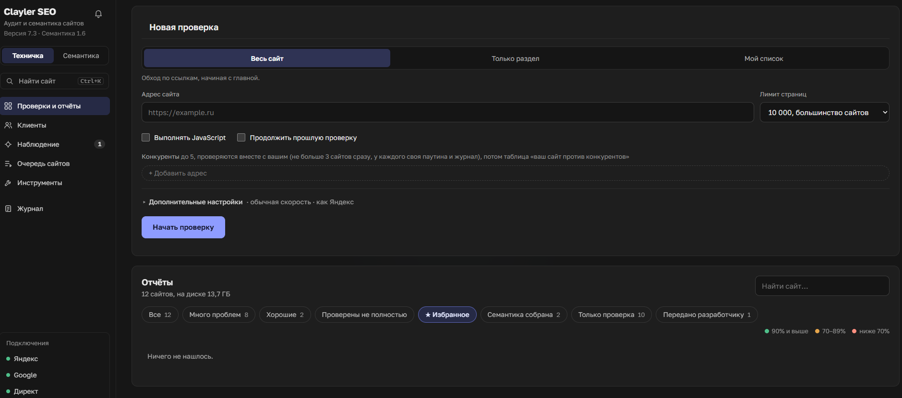
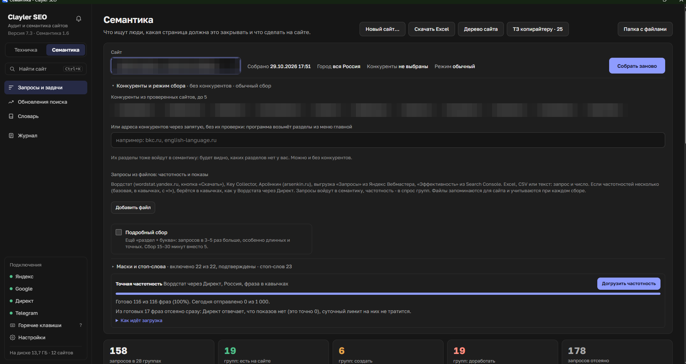
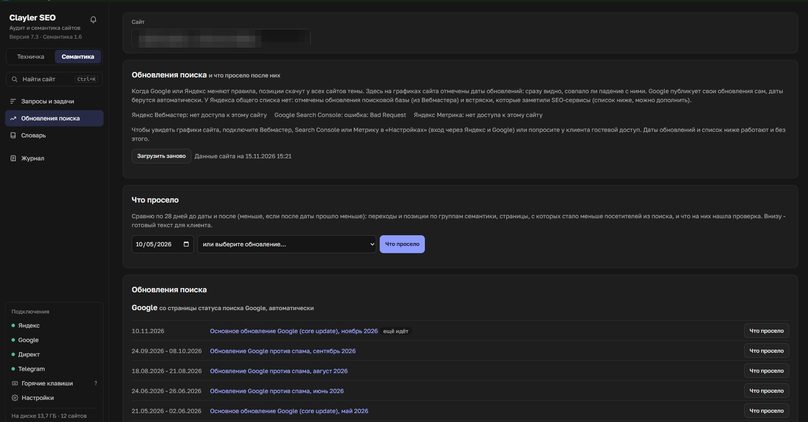
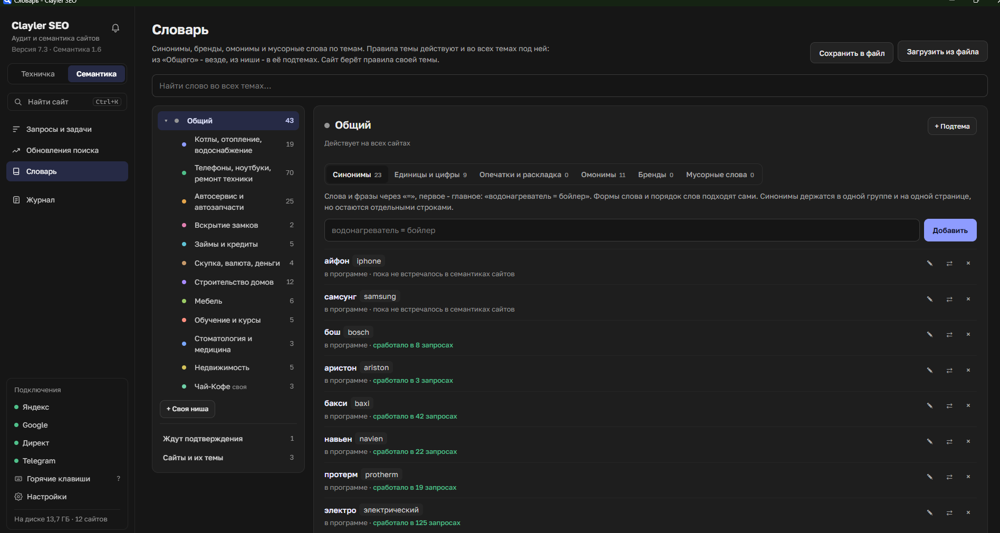
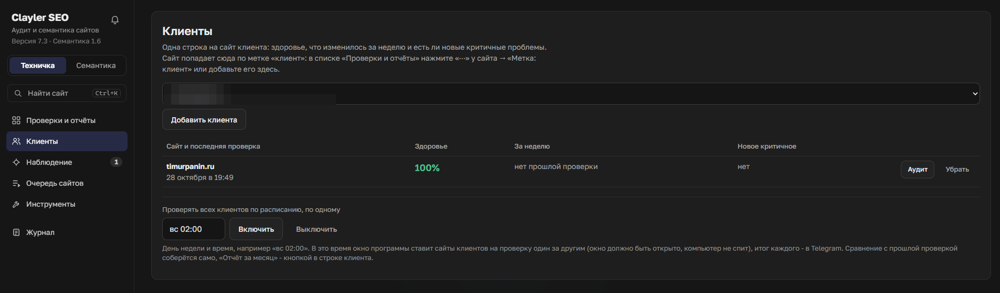
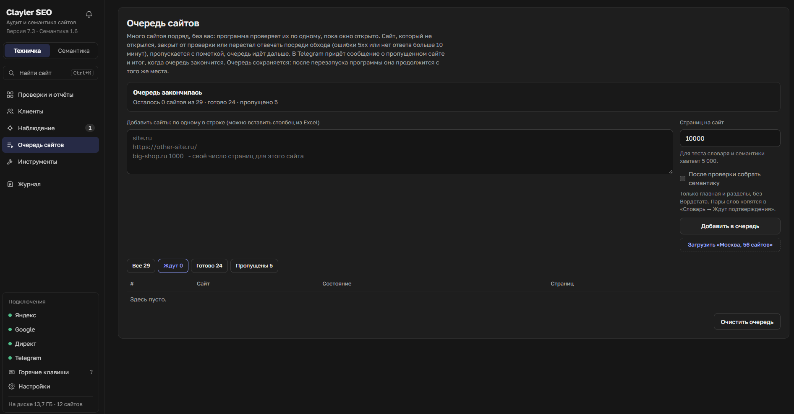
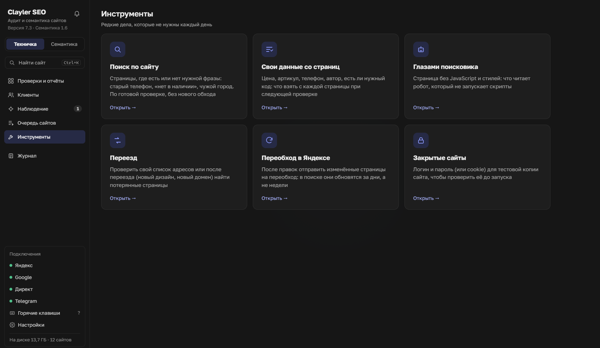
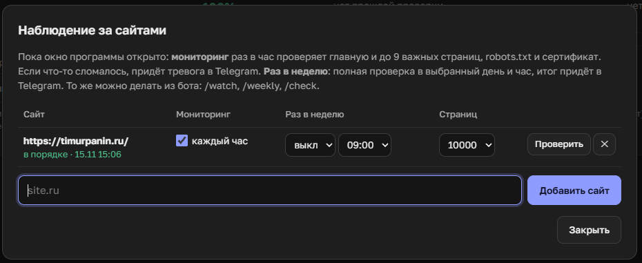
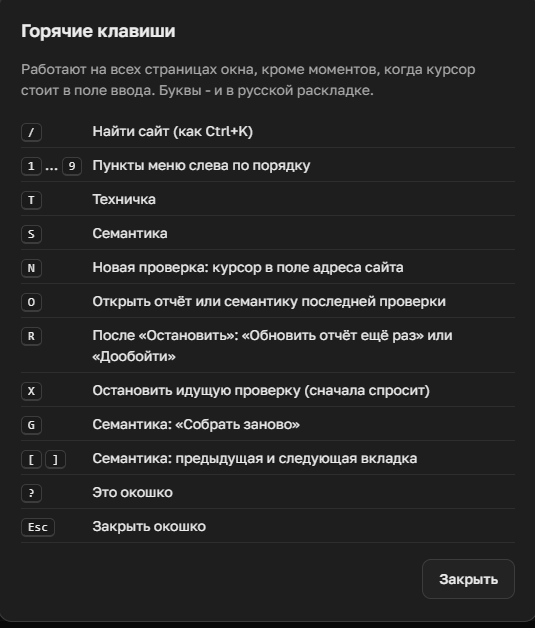
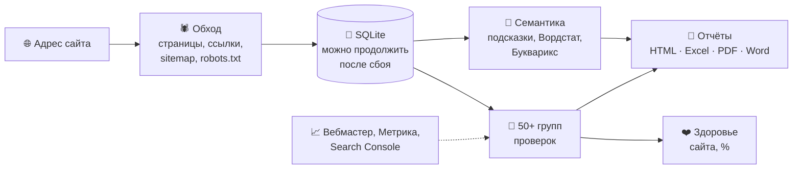

<div align="center">


# Clayler SEO

**Программа для технического SEO-аудита и сбора семантики сайтов**

Обходит сайт как поисковый робот, находит ошибки, считает «здоровье» сайта<br/>
и собирает готовые отчёты для себя, клиента и разработчика.


[Возможности](#-возможности) ·
[Скриншоты](#-скриншоты) ·
[Как это работает](#-как-это-работает) ·
[Быстрый старт](#-быстрый-старт) ·
[Подключения](#-подключения) ·
[Командная строка](#-командная-строка)

<br/>



</div>

---

## 📖 О программе

Clayler SEO помогает SEO-специалисту проверить сайт целиком. Вы вводите адрес, программа проходит по всем страницам, как это делает робот Яндекса или Google, и показывает, что мешает сайту попасть в поиск и продавать: битые ссылки, дубли, ошибки в title и H1, проблемы с индексацией, скоростью, мобильной версией и многое другое.

На выходе получается не просто список ошибок, а набор готовых документов: отчёт для себя, понятный аудит для клиента, задачи разработчику, смета и ТЗ копирайтеру.

**Кому пригодится:**

- SEO-специалистам и фрилансерам, которые делают аудиты сайтов для клиентов;
- владельцам сайтов и интернет-магазинов, которые хотят понять, что не так с сайтом;
- веб-студиям, которым нужно быстро проверить сайт перед сдачей или после переезда.

> [!NOTE]
> Программа работает **только на вашем компьютере**. Окно открывается в браузере по адресу `127.0.0.1`, из интернета к нему не подключиться. Отчёты, ключи доступа и настройки никуда не отправляются.

> [!IMPORTANT]
> **Программа сделана для Windows 10 и 11.** На Mac и Linux она запускается, но работает не полностью: нет запуска двойным щелчком, PDF может не собираться, ключи хранятся без шифрования. Подробнее: [macOS и Linux](#macos-и-linux).

> [!TIP]
> **Лень читать инструкцию?** Дайте [Claude](https://claude.ai) ссылку на этот репозиторий и скажите: «Установи мне эту программу». Он сам всё скачает, поставит и запустит, а вам останется только ввести адрес сайта. 😉

---

## ✨ Возможности

### 🔍 Технический аудит

- **Обход сайта как у поискового робота:** по ссылкам и sitemap.xml, с учётом robots.txt (правила Google или Яндекса, Clean-param).
- **Больше 200 видов проблем** в 50+ группах проверок: коды ответа, редиректы и их цепочки, canonical, noindex, дубли, title, description и H1, ЧПУ, пагинация, hreflang, микроразметка Schema.org и Open Graph, смешанный контент, HTTPS, зеркала и склейка домена.
- **Режим JavaScript:** страницы открываются во встроенном Chromium так, как их видит Google. Подходит для сайтов на React, Vue и Angular.
- **Скорость и мобильная версия:** как страница грузится и выглядит на телефоне, со снимками экрана.
- **Безопасность:** открытые служебные файлы, признаки взлома, скрытые ссылки, клоакинг.
- **Тексты:** орфография (Яндекс.Спеллер), водность и тошнота, каннибализация запросов, смешанные русские и латинские буквы.
- **«Что мешает покупать»:** программа сама нажимает «В корзину» и «Купить в один клик», проверяет формы, согласие на обработку данных и наличие товара.
- **Здоровье сайта в процентах:** одна понятная цифра, по которой видно, стало лучше или хуже.

### 📊 Отчёты

Каждая проверка лежит в своей папке `reports/<сайт>_<дата>_<время>/`. Имена файлов внутри на русском: их отправляют клиенту, и так понятнее.

| Файл | Для кого | Что внутри |
|---|---|---|
| `отчёт.html` | для себя | все проблемы и страницы, схема внутренних ссылок («паутинка»), фильтры |
| `отчёт_для_клиента.html` | клиенту | полный отчёт простыми словами, открывается без программы |
| `аудит.html`, `аудит.docx` и PDF | клиенту | аудит по 20 пунктам; PDF печатается через Chrome или Edge, которые уже стоят на компьютере |
| `экспресс.html` | будущему клиенту | экспресс-аудит на один лист: здоровье сайта и 5 главных проблем |
| `карточка.html` | для себя | всё главное о сайте на одной странице |
| `отчёт.xlsx` и CSV | для работы | сводка, список проблем с объяснениями, все страницы |
| `смета.xlsx` | клиенту | смета и план работ по найденным проблемам |
| `Задачи разработчику.docx` | разработчику | что исправить и где, с советами под движок сайта (после сбора семантики) |
| `ТЗ копирайтеру.docx` | копирайтеру | задания на тексты по группам запросов (после сбора семантики) |

Кроме того, в папке `для клиента` собираются файлы с понятными именами для отправки, а программа готовит **файлы-исправления** (robots.txt, sitemap.xml) и **снимки страниц с обведённой ошибкой**.

### 🧠 Семантика

- Поисковые подсказки Яндекса и Google, то есть то, что люди на самом деле набирают в поиске.
- Точная частотность из Вордстата через API Яндекс Директа.
- Запросы своего сайта и конкурентов из Букварикса (бесплатно).
- Группы запросов, правило «запрос → страница», каннибализация, бренды и модели товаров, синонимы, города.
- Семантика для сайта, которого ещё нет: структура будущего сайта.
- GEO: готовность сайта к ответам нейросетей (Нейро в Яндексе, Алиса, ChatGPT, Perplexity).
- Словарь синонимов, брендов, омонимов и мусорных слов по нишам.

### 📈 Данные поисковиков

После входа в свой аккаунт программа добавляет в отчёт данные **Яндекс Вебмастера**, **Яндекс Метрики** и **Google Search Console**: что в индексе, какие страницы потеряли показы, где теряются клики. Отдельная вкладка показывает **обновления поиска** Google и Яндекса и что просело после них. Вход без пароля, через страницу Яндекса или Google, доступ только на чтение.

### 🤝 Работа с клиентами и автоматизация

- **Клиенты:** свои данные и логотип в отчётах, папка «для клиента» с файлами, ежемесячный отчёт об изменениях, проверка всех клиентов по расписанию.
- **Сравнение** двух проверок одного сайта (что исправили, что сломалось) и **сравнение с конкурентами** (до 5 сайтов одновременно).
- **Метки у проблем:** «не ошибка», «передано разработчику» и другие, чтобы вести работу по сайту.
- **Очередь сайтов:** список проверяется сам, по одному, например ночью.
- **Наблюдение:** мониторинг каждый час и полная проверка раз в неделю, пока окно открыто.
- **Уведомления** со звуком в окне, в Windows и в **Telegram** через своего бота (команды `/status`, `/last`, `/watch`, `/check`).
- **Инструменты:** поиск фразы по готовой проверке, свои данные со страниц (цена, артикул, телефон), «глазами поисковика», проверка переезда, переобход в Яндексе, закрытые тестовые сайты.
- **Горячие клавиши** для всех основных действий.

---

## 📸 Скриншоты

<table>
  <tr>
    <td width="50%" valign="top">
      <a href="docs/screenshots/semantics.png"></a>
      <p align="center"><b>Семантика</b><br/><sub>подсказки, точная частотность, группы запросов</sub></p>
    </td>
    <td width="50%" valign="top">
      <a href="docs/screenshots/search-updates.png"></a>
      <p align="center"><b>Обновления поиска</b><br/><sub>что просело после обновлений Google и Яндекса</sub></p>
    </td>
  </tr>
  <tr>
    <td width="50%" valign="top">
      <a href="docs/screenshots/dictionary.png"></a>
      <p align="center"><b>Словарь</b><br/><sub>синонимы, бренды и мусорные слова по нишам</sub></p>
    </td>
    <td width="50%" valign="top">
      <a href="docs/screenshots/clients.png"></a>
      <p align="center"><b>Клиенты</b><br/><sub>здоровье сайтов и проверка по расписанию</sub></p>
    </td>
  </tr>
  <tr>
    <td width="50%" valign="top">
      <a href="docs/screenshots/queue.png"></a>
      <p align="center"><b>Очередь сайтов</b><br/><sub>много сайтов подряд, без вашего участия</sub></p>
    </td>
    <td width="50%" valign="top">
      <a href="docs/screenshots/tools.png"></a>
      <p align="center"><b>Инструменты</b><br/><sub>поиск по сайту, переезд, переобход и другое</sub></p>
    </td>
  </tr>
  <tr>
    <td width="50%" valign="top">
      <a href="docs/screenshots/monitoring.png"></a>
      <p align="center"><b>Наблюдение</b><br/><sub>мониторинг каждый час, тревога в Telegram</sub></p>
    </td>
    <td width="50%" valign="top">
      <a href="docs/screenshots/hotkeys.png"></a>
      <p align="center"><b>Горячие клавиши</b><br/><sub>работают и в русской раскладке</sub></p>
    </td>
  </tr>
</table>

---

## 🔧 Как это работает



1. **Обход.** Программа загружает главную страницу и идёт по ссылкам, как поисковый робот. Каждый шаг редиректа записывается отдельно, адреса приводятся к одному виду, лишние параметры отбрасываются. Всё сохраняется в базу SQLite, поэтому прерванную проверку можно продолжить.
2. **Проверки.** Когда обход закончен, по собранным данным запускаются проверки. Каждая отвечает за свою тему и находит свои проблемы.
3. **Данные поисковиков.** Если подключены Яндекс и Google, программа добавляет их данные к тому, что нашла сама.
4. **Отчёты.** Из одних и тех же результатов собираются отчёты для разных людей: для себя, клиента, разработчика и копирайтера.

Окно программы работает как небольшой веб-сервер на Python. Он открывает страницу в вашем браузере, но доступен только на этом компьютере.

---

## 🚀 Быстрый старт

### Что нужно

- **Windows 10 или 11** (на других системах запуск вручную, см. ниже);
- **Python 3.9 или новее** ([скачать с python.org](https://www.python.org/downloads/)). При установке поставьте галочку **«Add python.exe to PATH»**.

### Установка и запуск

1. Скачайте программу: зелёная кнопка **Code → Download ZIP** вверху этой страницы или команда

   ```bash
   git clone https://github.com/TimurPanin/Clayler-SEO.git
   ```

2. Распакуйте архив и дважды щёлкните **`Clayler SEO.bat`**.
3. При первом запуске программа **сама поставит всё нужное**: модули Python и встроенный браузер Chromium. Нужен интернет, скачается около 150-200 МБ, это займёт несколько минут. Следующие запуски сразу открывают окно программы.
4. Введите адрес сайта и нажмите **«Начать проверку»**.

> [!TIP]
> Есть и простой режим без окна: **`Запустить аудит.bat`** задаст 4 вопроса (адрес, сколько страниц, нужен ли JavaScript…) и откроет готовый отчёт в браузере.

### Встроенный браузер Chromium

Chromium ставится сам при первом запуске, поэтому все возможности работают сразу. Он нужен для:

- **снимков страниц с обведённой ошибкой** в отчётах («Нет H1», мелкий текст, маленькие кнопки);
- **вида страниц на телефоне** и проверки мобильной версии;
- **скорости «как у посетителя с телефона»**;
- **«Что мешает покупать»**: программа сама нажимает «В корзину» и «Купить в один клик»;
- **проверки с JavaScript** (галочка «Выполнять JavaScript») для сайтов на React, Vue и Angular.

Если при первом запуске не было интернета, программа всё равно откроется и сделает полный отчёт, только без этих снимков и разделов, а браузер попробует поставить при следующем запуске. Поставить его вручную можно одной командой:

```bash
python crawl.py --setup-js
```

> [!WARNING]
> С галочкой «Выполнять JavaScript» проверка идёт в несколько раз медленнее: каждая страница открывается в настоящем браузере.

### macOS и Linux

Программа писалась и проверялась под Windows. На Mac и Linux её можно запустить из терминала:

```bash
pip install -r requirements.txt
python crawl.py --setup-js
python app.py
```

Сама проверка сайта, отчёты в HTML, Excel и Word, семантика и снимки страниц работают так же. Но есть отличия:

| Что | Windows | Mac и Linux |
|---|---|---|
| Запуск двойным щелчком (`.bat`) | ✅ | ❌ только из терминала |
| Установка всего нужного при первом запуске | ✅ сама | ❌ командами выше |
| PDF-отчёт | ✅ через Chrome или Edge | ⚠️ может не собраться: программа ищет браузер там, где он стоит в Windows |
| Шифрование ключей Яндекса, Google и Telegram | ✅ средствами Windows | ⚠️ ключи хранятся в файле без шифрования |
| Уведомления и звуки | ✅ | ❌ только в окне программы и в Telegram |

Если нужна полная версия, проще всего запускать программу на Windows.

---

## 🔌 Подключения

Все подключения необязательны: без них программа делает полный технический аудит. Подключаются они в окне программы, в блоке **«Подключения»** слева. Там же есть пошаговая подсказка для каждого сервиса.

| Сервис | Что даёт | Что нужно один раз |
|---|---|---|
| **Яндекс Вебмастер и Метрика** | индексация, запросы, посещаемость, потерянные клики | своё приложение на [oauth.yandex.ru](https://oauth.yandex.ru/client/new): ClientID и секрет |
| **Google Search Console** | показы, клики, страницы вне индекса | свой проект в [Google Cloud](https://console.cloud.google.com/), клиент типа Desktop app |
| **Яндекс Директ** | точная частотность из Вордстата | client_id и токен (ссылка на получение есть в окне программы) |
| **Telegram** | сообщение, когда проверка закончилась или застряла | свой бот от [@BotFather](https://t.me/BotFather) и его токен |
| **Букварикс** | запросы сайта и конкурентов | ничего, работает бесплатно |

### 🔐 Где хранятся ключи

- Ключи и токены лежат в файле `data/доступы.json` **только на вашем компьютере**. Этот файл исключён из git.
- На Windows они зашифрованы средствами системы (DPAPI): расшифровать их может только ваша учётная запись Windows.
- Вход в Яндекс и Google без пароля: вы входите на их странице и нажимаете «Разрешить». Программа получает доступ **только на чтение**, а кнопка «Отключить» отзывает его.
- В журнал программы токены и пароли не попадают, вместо них пишется `•••`.

---

## 💻 Командная строка

Всё, что делает окно, можно запустить и из командной строки:

```bash
# Проверить сайт (по умолчанию до 10 000 страниц)
python crawl.py https://example.ru

# Большой сайт: больше страниц и потоков
python crawl.py https://example.ru --max-pages 50000 --threads 8

# Как видит робот Яндекса, с выполнением JavaScript
python crawl.py https://example.ru --robots yandex --ua yandexbot --js

# Продолжить прерванную проверку
python crawl.py https://example.ru --continue

# Проверить только адреса из файла (как режим List у Screaming Frog)
python crawl.py --list адреса.txt

# Сравнить две проверки одного сайта
python crawl.py --compare "reports/старая" "reports/новая"
```

Полный список параметров: `python crawl.py --help`.

---

## 📁 Структура проекта

```
Clayler-SEO/
├── Clayler SEO.bat        # запуск окна программы (двойной щелчок)
├── Запустить аудит.bat    # простой режим: 4 вопроса и готовый отчёт
├── app.py                 # окно программы (локальный сервер на 127.0.0.1)
├── crawl.py               # запуск из командной строки
├── seocrawler/
│   ├── crawler/           # обход сайта
│   ├── analyze/           # проверки и расчёт здоровья
│   │   └── checks/        # 50+ групп проверок, каждая в своём файле
│   ├── semantics/         # семантика: подсказки, Вордстат, группы, ТЗ
│   ├── window/            # окно программы: сервер и страницы
│   ├── run/               # сценарии запуска: обход, отчёт, сравнение
│   └── *.py               # отчёты, аудит, подключения, Telegram, очередь…
├── data/                  # ваши личные файлы (в git попадает только иконка)
├── docs/screenshots/      # скриншоты для этой страницы
├── reports/               # готовые проверки (создаётся при первой проверке)
└── tests/                 # автотесты и тестовые сайты
```

Около **49 000 строк** кода на Python. Для обхода и разбора страниц хватает стандартной библиотеки Python, сторонние модули нужны только для Excel, HTTPS и режима JavaScript.

---

## 🧪 Тесты

В папке `tests/` больше 100 автотестов и несколько тестовых сайтов. Главный тест поднимает на компьютере тестовые сайты с заранее известными ошибками, проверяет каждый программой и сверяет найденное с эталоном:

```bash
python tests/проверить_всё.py
```

---

## 🗺️ Известные ограничения

- В режиме JavaScript большие сайты проверяются долго, а страницы с тяжёлыми скриптами открываются медленно.
- Программа рассчитана на Windows. На Mac и Linux нет запуска двойным щелчком, PDF может не собираться, а ключи хранятся без шифрования ([подробнее](#macos-и-linux)).
- Интерфейс и отчёты на русском языке, программа ориентирована на Яндекс и Google в Рунете.

---

## 📄 Лицензия

Программа распространяется по лицензии [MIT](LICENSE): её можно свободно использовать, менять и распространять, если сохранить указание автора.

---

## 👤 Автор

**Тимур Панин** · [GitHub](https://github.com/TimurPanin) · [timurpanin.ru](https://timurpanin.ru)

Это мой первый большой проект. Если программа оказалась полезной, поставьте ⭐ репозиторию, а если нашли ошибку, напишите в [Issues](https://github.com/TimurPanin/Clayler-SEO/issues).
